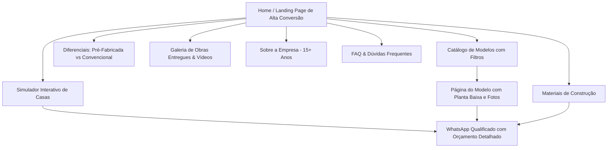

# 🏗️ Engenharia Reversa & Especificação Técnica: Shopping das Casas
**Análise do Perfil Instagram [@shoppingdascasas](https://www.instagram.com/shoppingdascasas/) e Projeto do Novo Site**

---

## 1. Diagnóstico do Perfil e Engenharia Reversa da Marca

### 1.1 Raio-X do Perfil (@shoppingdascasas)
* **Nome de Exibição:** Casas e Material de Construção (@shoppingdascasas)
* **Audiência:** +138.000 seguidores orgânicos, alto engajamento em vídeos de obras e entregas de chaves.
* **Segmento Principal:** Construção de Casas Pré-Fabricadas (Concreto e Madeira Nobre/Tratada) e Loja de Materiais de Construção.
* **Fundação e Credibilidade:** Mais de 15 anos de história (fundada em 2010), sede estabelecida na divisa de Araquari e Joinville - SC.
* **Canais de Contato:**
  * WhatsApp Comercial: `(47) 99133-7816`
  * Telefone Fixo: `(47) 3454-4035`
  * Horários: Segunda a Sexta: 07:30 às 17:30 | Sábado: 07:30 às 12:00
* **Área Geográfica de Atuação Principal:** Norte de Santa Catarina, Vale do Itapocu e Litoral Norte (Araquari, Joinville, Barra do Sul, São Francisco do Sul, Itapoá, Guaramirim, Jaraguá do Sul, Garuva).

---

### 1.2 Identidade Visual Identificada
| Elemento | Especificação Extraída | Aplicação no Site |
| :--- | :--- | :--- |
| **Cor Primária (Verde Construção)** | `#0F5132` / `#198754` | Transmite solidez, natureza, madeira tratada e sustentabilidade |
| **Cor Secundária (Laranja Telha/Ação)** | `#E65100` / `#FF6F00` | Botões de CTA, preços a partir de, selos de destaque, calor |
| **Cores de Apoio** | `#1A202C` (Grafite Escuro), `#F8F9FA` (Gelo), `#FFFFFF` | Fundos limpos, alto contraste e legibilidade impecável |
| **Logotipo** | Traçado estilizado de telhado com faixas coloridas e tipografia sem serifa sólida | Header fixo com animação sutil e ícone responsivo |
| **Tipografia Recomendada** | `Plus Jakarta Sans` ou `Outfit` + `Inter` | Moderna, tecnológica, robusta e de alta conversão |

---

### 1.3 Produtos e Soluções Oferecidas
1. **Casas Pré-Moldadas de Concreto / Alvenaria:**
   * Placas e colunas estruturais em concreto usinado;
   * Alta durabilidade, resistência climática do litoral catarinense, isolamento acústico;
   * Aceita acabamento fino em massa corrida, textura e pintura convencional.
2. **Casas Pré-Fabricadas em Madeira Tratada:**
   * Pinus Autoclavado e Eucalipto tratado em autoclave (garantia contra cupins e umidade);
   * Modelos rústicos, chalés modernos e estilo colonial;
   * Conforto térmico natural para inverno e verão.
3. **Casas Mistas (Concreto + Madeira):**
   * Áreas molhadas (cozinha, banheiro, lavanderia) em alvenaria/concreto;
   * Áreas sociais e íntimas (quartos e salas) em madeira nobre ou tratada.
4. **Loja de Materiais de Construção:**
   * Fornecimento do básico ao acabamento: areia, brita, cimento, ferragens, telhas cerâmicas e esmaltadas, madeiramento de teto, portas e esquadrias de alumínio/madeira.

---

### 1.4 Análise dos Gargalos Atuais (Por que o site é vital?)
Atualmente, a empresa concentra grande parte do tráfego no Instagram, o que gera:
1. **Sobrecarga de Atendimento:** Vendedores gastam horas respondendo as mesmas perguntas ("Qual o valor da casa de 2 quartos?", "Entrega em São Chico?", "O que vem incluso?").
2. **Falta de Qualificação de Lead:** Clientes sem terreno ou sem clareza orçamentária chegam no WhatsApp sem filtro.
3. **Ausência de Simulador Interativo:** Quem quer construir quer poder calcular parcelas, escolher dormitórios e ver a estimativa de preço instantaneamente.
4. **Dependência de Algoritmo:** A base de 138k seguidores pode ser monetizada com muito mais eficácia com um site indexado no Google (SEO local) e funil de conversão próprio.

---

## 2. Proposta de Valor & Personas Identificadas

### 🎯 Personas Principais
* **Persona 1: A Conquista da Casa Própria (Família Jovem / Casal)**
  * *Necessidade:* Sair do aluguel com orçamento controlado (casas a partir de R$ 37.500).
  * *Medo:* Gastar mais do que o combinado e obra demorar meses/anos.
  * *Argumento de Venda:* Preço fixo em contrato, entrega em até 30-45 dias, financiamento facilitado e uso de FGTS/veículo.
* **Persona 2: O Refúgio de Férias / Praia / Chácara**
  * *Necessidade:* Construir casa de veraneio em Balneário Barra do Sul, Itapoá ou São Francisco do Sul, ou chácara no interior.
  * *Medo:* Dor de cabeça para gerenciar pedreiro à distância.
  * *Argumento de Venda:* Kit pronto montado pela equipe da fábrica, chave na mão, manutenção simplificada.
* **Persona 3: O Investidor de Locação (Airbnb / Locação Anual)**
  * *Necessidade:* Construir chalés ou casas compactas de 1 ou 2 quartos no mesmo lote para aluguel.
  * *Argumento de Venda:* Altíssimo ROI, custo por m² imbatível e rapidez extrema para começar a faturar.

---

## 3. Arquitetura de Informação do Novo Site

### Seções Detalhadas da Página:

1. **Header Fixo (Topbar + Navbar):**
   * Topbar com localização (*"Showroom em Araquari - SC | Atendemos todo o Norte de SC e Litoral"*) + WhatsApp e Horários.
   * Navbar com Logo oficial, links âncora (*Modelos*, *Simulador*, *Vantagens*, *Obras*, *Materiais*, *Sobre Nós*) e botão em destaque **"Simular Casa Agora"**.

2. **Hero Section (Primeira Dobra):**
   * Headline de alto impacto: *"Sua Casa Própria em até 30 Dias com a Segurança de Mais de 15 Anos de Mercado"*.
   * Subheadline: *"Casas pré-moldadas em concreto e madeira tratada a partir de R$ 37.500. Obra rápida, preço fixado em contrato e sem surpresas."*
   * 3 Badges de Autoridade: `+138k Seguidores`, `+15 Anos em SC`, `+2.000 Casas Entregues`.
   * CTA Duplo: `[Explorar Modelos]` e `[Simular Financiamento]`.

3. **Simulador Interativo de Casa (Lead Magnet Central):**
   * Passo 1: Quantidade de quartos (1, 2 ou 3 dormitórios).
   * Passo 2: Tipo de estrutura (Concreto Pré-Moldado, Madeira Tratada ou Mista).
   * Passo 3: Metragem desejada (36m², 45m², 54m², 63m², 72m²+).
   * Passo 4: Cidade onde será a obra (Araquari, Joinville, Barra do Sul, São Chico, etc.).
   * Resultado em tempo real: Estimativa de valor + estimativa de parcela + botão que gera mensagem automática estruturada no WhatsApp do consultor!

4. **Vitrine / Catálogo de Modelos:**
   * Filtros por número de dormitórios (1Q, 2Q, 3Q), material (Concreto / Madeira) e faixa de preço.
   * Cards com foto render/real, metragem em m², quantidade de dormitórios, banheiros e varanda.
   * Modal ou página com Planta Baixa Humanizada, o que está incluso no kit e galeria de fotos.

5. **Comparativo Transparente (Pré-Fabricada vs Alvenaria Tradicional):**
   * Tabela interativa comparando:
     * Prazo de obra: **25 a 40 dias** vs *6 a 12 meses*
     * Desperdício de entulho: **Quase zero (sustentável)** vs *20% a 30% de perda*
     * Custo final: **Preço fixo em contrato** vs *Aditivos e imprevistos frequentes*
     * Economia total: **Até 35% mais em conta**

6. **Galeria de Obras Reais & Depoimentos:**
   * Fotos de casas montadas com entrega de chaves.
   * Feed ou carrossel integrado com estética do Instagram.
   * Depoimentos em vídeo e texto de clientes reais da região.

7. **Seção de Materiais de Construção:**
   * Destaque para aberturas, madeiras brutas e beneficiadas, telhas e ferragens.
   * Atendimento balcão com orçamento expresso.

8. **Localização & Showroom:**
   * Mapa interativo Google Maps (Rua Waldemiro José Borges / SC-418 / Araquari-Joinville).
   * Convite para tomar um café e conhecer a casa modelo no showroom.

9. **FAQ (Perguntas Frequentes):**
   * O que precisa ter no terreno antes de começar?
   * A madeira tratada tem garantia contra cupim e apodrecimento?
   * Como funciona o pagamento e financiamento?
   * É possível personalizar a planta baixa?

10. **Rodapé Completo & Floating WhatsApp Button:**
    * CNPJ, endereço completo, links úteis, redes sociais (Instagram @shoppingdascasas, Facebook, YouTube) e botão pulsante com mensagem predefinida.

---

## 4. Requisitos Técnicos & Estratégia de Performance

* **Stack Recomendada:** HTML5 Semântico, CSS Moderno com Design System sob medida (variáveis CSS, tema claro/escuro elegante, micro-animações fluidas sem bibliotecas pesadas) e JavaScript Vanilla modular.
* **SEO Local & Schema Markup:**
  * Metatags OpenGraph e Twitter Cards configuradas para compartilhamento no WhatsApp/Instagram.
  * Schema.org do tipo `LocalBusiness` e `HomeAndConstructionBusiness` com geolocalização exata para o Google Meu Negócio / Maps.
* **Conversão & Tracking:**
  * DataLayer pronto para Google Tag Manager, Meta Pixel (Facebook Ads) e GA4.
  * Eventos disparados: `clique_whatsapp_header`, `simulador_concluido`, `abrir_modelo_casa`, `agendamento_visita`.
